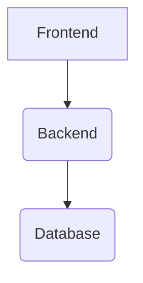

[Go 보안으로 돌아가기](/security)

## 개요

Go는 개발자가 공격자가 악용할 수 있는 취약점이나 결점을 감지, 평가, 해결하는 데 도움이 됩니다. Go 팀은 방화벽 관련 보고서를 수집하는 파이프라인을 운영합니다. 이러한 보고서는 Go 취약점 데이터베이스에 저장됩니다. 다양한 라이브러리와 도구는 이러한 보고서를 읽고 분석하여 특정 사용자 프로젝트가 어떻게 영향을 받을 수 있는지 이해할 수 있습니다. 이러한 기능은 [Go 패키지 검색 사이트](https://pkg.go.dev) 및 새로운 CLI 도구인 govulncheck에 통합되어 있습니다.

이 프로젝트는 현재 개발 중인 단계이며, 활발하게 개발되고 있습니다.
피드백을 제공해주시면 개선하는 데 도움이 됩니다. [피드백](#feedback)

**참고**: Go 프로젝트의 취약점을 보고하려면 [Go 보안 정책](/security/policy)을 참조하십시오.

## 아키텍처

```
## 아키텍처
```

## Components

*   Frontend
*   Backend
*   Database

## Diagram



## Technologies

*   React
*   Node.js
*   PostgreSQL

```markdown
<div class="image">
  <center>
    
  </center>
</div>
```

Go에서 취약점 관리는 다음과 같은 주요 구성 요소로 이루어집니다:

1. **데이터 파이프라인**은 다양한 소스에서 취약점 정보를 수집합니다.
    * [National Vulnerability Database (NVD)](https://nvd.nist.gov/)
    * [GitHub Advisory Database](https://github.com/advisories)
    * 그리고 [직접 Go 패키지 유지 관리자로부터](https://s/vulndb-report-new)
2. **취약점 데이터베이스**는 데이터 파이프라인에서 수집된 정보를 사용하여 채워집니다.
    * 데이터베이스에 있는 모든 보고서는 Go Security 팀에서 검토하고 관리합니다.
    * 보고서는 [Open Source Vulnerability (OSV) 형식](https://ossf.github.io/osv-schema/)으로 작성되며, [API](https://security/vuln/database#api)를 통해 접근할 수 있습니다.
3. [pkg.go.dev](https://pkg.go.dev) 및 govulncheck과의 **통합**을 통해 개발자가 프로젝트에서 취약점을 찾을 수 있도록 합니다.
    * [govulncheck 명령](https://pkg.go.dev/golang.org/x/vuln/cmd/govulncheck)은 코드를 분석하여 실제로 영향을 미치는 취약점만 표시합니다. 이는 코드 내에서 상호 호출되는 취약한 함수를 기반으로 합니다. Govulncheck는 프로젝트에서 알려진 취약점을 찾을 수 있는 신뢰할 수 있는 방법을 제공합니다.

## 참고 자료

### Go 취약점 데이터베이스

### Go Vulnerability Database

```
package main

import (
    "fmt"
    "log"
)

func main() {
    fmt.Println("Hello, World!")
}
```

[Go 취약점 데이터베이스](https://vuln.go.dev)는 Go 패키지 유지 관리자의 직접 보고뿐만 아니라 다양한 기존 소스에서 정보를 포함합니다.
데이터베이스의 각 항목은 취약점의 설명, 패키지 및 심볼 정보, 버전 세부 정보가 정확한지 확인하기 위해 검토됩니다.

자세한 내용은 [go.dev/security/vuln/database] 에서 확인하십시오.
Go 취약점 데이터베이스에 대한 정보는 다음과 같습니다.

또한 [pkg.go.dev/vuln](https://pkg.go.dev/vuln) 에서 브라우저에서 데이터베이스의 취약점을 확인할 수 있습니다.

저희는 패키지 관리자분들께 [기여](feedback)하여
자신의 프로젝트에 대한 공개적인 취약점에 대한 정보를 제공하고
[제안 보내기](https://s/vuln-feedback)를 통해
불편함을 줄이는 방법에 대한 제안을 보내주실 것을 권장합니다.

### Go를 위한 취약점 감지

Go의 취약점 탐지 기능은 Go 사용자가 프로젝트에 영향을 미칠 수 있는 알려진 취약점에 대해 신뢰성 있고 낮은 노이즈 방식으로 학습할 수 있도록 하는 것을 목표로 합니다.
취약점 검사는 Go의 도구 및 서비스에 통합되어 있으며, 여기에는 새로운 명령줄 도구인 [govulncheck](https://pkg.go.dev/golang.org/x/vuln/cmd/govulncheck), [Go 패키지 검색 사이트](https://pkg.go.dev), 주요 편집기(예: VS Code)와 Go 확장과 같은 도구가 포함됩니다.

`govulncheck`을 사용하려면, 다음 명령을 프로젝트 디렉토리에서 실행하세요:

$ go install golang.org/x/vuln/cmd/govulncheck@latest
$ govulncheck ./...

에디터에서 취약점 탐지 기능을 활성화하려면, [에디터 통합](/security/vuln/editor) 페이지의 지침을 참조하십시오.

### Go CNA

Go 보안 팀은 [CVE 번호 지정 기관](https://www.cve.org/ProgramOrganization/CNAs)입니다.
자세한 내용은 [go.dev/security/vuln/cna](/security/vuln/cna)를 참조하세요.

## 피드백

저희는 여러분의 기여를 환영하며, 다음과 같은 방법으로 저희가 개선하는 데 도움을 주실 수 있기를 바랍니다:

- [새로운 정보 기여](/s/vulndb-report-new)하고
  기존 정보를 [업데이트](/s/vulndb-report-feedback)하여
  당신이 관리하는 Go 패키지의 공개 취약점에 대한 정보를 제공하세요
- [govulncheck 사용 경험을 공유하기 위해 이 설문 조사에 참여하세요](/s/govulncheck-feedback)
- [문제 및 기능 요청에 대한 피드백을 보내주세요](/s/vuln-feedback)

## 자주 묻는 질문

**Go 프로젝트의 취약점을 어떻게 보고해야 할까요?**

다음 단계를 따르세요:

1.  **취약점을 찾으세요.**
    *   코드를 주의 깊게 검토하세요.
    *   정규 표현 또는 기타 도구를 사용하여 잠재적인 취약점을 검색하세요.
    *   다른 개발자의 피드백을 요청하세요.

2.  **취약점을 자세히 설명하세요.**
    *   취약점의 이름, 위치, 영향을 명확하게 설명하세요.
    *   가능한 경우, 취약점을 재현하는 단계를 제공하세요.
    *   취약점을 악용하는 데 필요한 정보 (예: 필요한 권한, 입력 값)를 포함하세요.

3.  **취약점을 보고하세요.**
    *   프로젝트의 GitHub 저장소에 Issue를 생성하세요.
    *   제목에 명확하고 간결한 제목을 사용하세요 (예: "Critical vulnerability in authentication module").
    *   문제 설명 섹션에 자세한 정보를 제공하세요.
    *   가능한 경우, 관련 코드를 첨부하세요.
    *   다른 개발자의 피드백을 요청하세요.

4.  **개발자와 협력하세요.**
    *   개발자가 제공하는 정보에 응답하세요.
    *   필요한 경우, 추가 정보를 제공하세요.
    *   해결책에 대한 피드백을 제공하세요.

**예시:**

```markdown
## 취약점 보고 템플릿

| 항목 | 설명 |
|---|---|
| 취약점 이름 |  |
| 위치 |  |
| 영향 |  |
| 재현 단계 |  |
| 필요한 정보 |  |
| 관련 코드 |  |

```

Go 프로젝트의 모든 보안 버그를 이메일로 [security@golang.org](mailto:security@golang.org)로 보고하십시오.
자세한 내용은 [Go 보안 정책](/security/policy)를 참조하십시오.

**Go 취약점 데이터베이스에 공개 취약점을 추가하는 방법은 무엇입니까?**

공개된 취약점을 Go 취약점 데이터베이스에 추가하기 위해,
[이 양식을 작성해주세요](/s/vulndb-report-new).

취약점은 다음과 같은 경우에 공개 취약점으로 간주됩니다.
* 이미 공개적으로 알려진 경우
* 관리하는 패키지에 존재하는 경우 (그리고 공개할 준비가 되어 있는 경우)

이 양식은 Go 팀이 관리하지 않는, 가져올 수 있는 Go 패키지의 공개 취약점에만 사용됩니다 (Go 표준 라이브러리, Go 도구 체인, golang.org 모듈 외).

이 폼을 사용하여 새로운 CVE ID를 요청할 수도 있습니다.
[자세한 내용은 여기에서 확인하세요](/security/vuln/cna) Go CVE 번호 지정 기관에 대한 정보가 있습니다.

**취약점에 대한 수정 사항을 제안하는 방법은 무엇입니까?**

기존의 Go 취약점 데이터베이스 보고서에 대한 수정 사항을 제안하려면,
[이 양식을 작성하세요](/s/vulndb-report-feedback).

**govulncheck 관련 문제 보고 또는 피드백은 어떻게 해야 하나요?**

보고하거나 피드백을 제출하세요 [Go 이슈 추적기에서](/s/vuln-feedback).

**저는 다른 데이터베이스에서 이 취약점을 찾았습니다. 왜 이 취약점이 Go 취약점 데이터베이스에 포함되지 않았습니까?**

보고서는 다양한 이유로 Go 취약점 데이터베이스에서 제외될 수 있습니다.
여기에는 관련 취약점이 Go 패키지에 없는 경우,
취약점이 설치 가능한 명령에 있는 경우, 또는
기존에 데이터베이스에 존재하는 다른 취약점에 의해 포괄되는 경우 등이 포함됩니다.
Go 보안 팀의 [보고서 제외 이유에 대해 자세히 알아보려면](/security/vuln/database#excluded-reports)를 참조하십시오.
만약 보고서가 vuln.go.dev에서 잘못된 이유로 제외되었다고 생각되면,
[저희에게 알려주십시오](/s/vulndb-report-feedback).

**왜 Go 취약점 데이터베이스가 심각도 레이블을 사용하지 않나요?**

이 질문에 대한 답변은 다음과 같습니다.

Go 취약점 데이터베이스가 심각도 레이블을 사용하지 않는 데에는 몇 가지 이유가 있습니다.

*   **일관성 부족:** Go 취약점 데이터베이스는 다양한 출처에서 데이터를 수집합니다. 이러한 출처는 심각도 평가 기준이 다를 수 있습니다. 따라서 심각도 레이블을 일관되게 사용하는 것이 어렵습니다.
*   **주관성:** 심각도는 특정 상황에 따라 달라질 수 있습니다. 예를 들어, 취약점이 특정 환경에서만 영향을 미치는 경우, 다른 환경에서는 영향을 미치지 않을 수 있습니다. 이러한 경우, 심각도 레이블을 객관적으로 평가하기 어렵습니다.
*   **데이터 품질:** Go 취약점 데이터베이스의 데이터 품질은 출처에 따라 다릅니다. 일부 데이터는 정확하고 신뢰할 수 있는 반면, 다른 데이터는 부정확하거나 불완전할 수 있습니다. 심각도 레이블은 데이터 품질에 따라 달라질 수 있습니다.
*   **관심사:** Go 커뮤니티는 심각도 레이블보다는 취약점 자체에 더 집중하고 있습니다. Go 커뮤니티는 취약점을 해결하는 데 더 관심이 있습니다.

이러한 이유로 Go 취약점 데이터베이스는 심각도 레이블을 사용하지 않습니다.

대부분의 취약점 보고 형식은 "LOW", "MEDIUM", "CRITICAL"과 같은 심각도 레이블을 사용하여 다양한 취약점의 영향을 나타내고 개발자가 보안 문제를 우선순위로 정하도록 돕습니다.

그러나 여러 가지 이유로 Go는 이러한 레이블을 사용하지 않습니다.

취약점의 영향은 일반적으로 보편적이지 않으며,
이는 심각성 지표가 종종 오해를 불러일으킬 수 있음을 의미합니다.
예를 들어, 파서에서 발생하는 오류는 사용자로부터 제공된 입력을 파싱하는 데 사용될 경우, DoS 공격에 악용될 수 있으므로 심각한 문제로 간주될 수 있지만,
파서가 로컬 구성 파일을 파싱하는 데 사용되는 경우, 심각도를 "낮음"으로 지정하는 것 자체가 과장된 표현일 수 있습니다.

심각도 분류 또한 필연적으로 주관적입니다.
이는 [CVE 프로그램](https://www.cve.org/About/Overview)에 대한 설명이기도 합니다.
이 프로그램은 취약점의 관련 측면, 예를 들어 공격 벡터, 복잡성 및 악용 가능성을 분석하기 위한 공식적인 방법을 제시합니다.
그러나 이러한 모든 요소는 주관적인 평가를 필요로 합니다.

우리는 취약점에 대한 좋은 설명이 심각도 지표보다 더 유용하다고 생각합니다.
좋은 설명은 문제가 무엇인지,
어떻게 발생할 수 있는지, 그리고 사용자가 자신의 소프트웨어에 미치는 영향을 결정할 때 고려해야 할 사항을 설명할 수 있습니다.

만약 이 주제에 대해 저희와 의견을 공유하고 싶으시다면, [문제 제출](https://s/vuln-feedback)하십시오.
